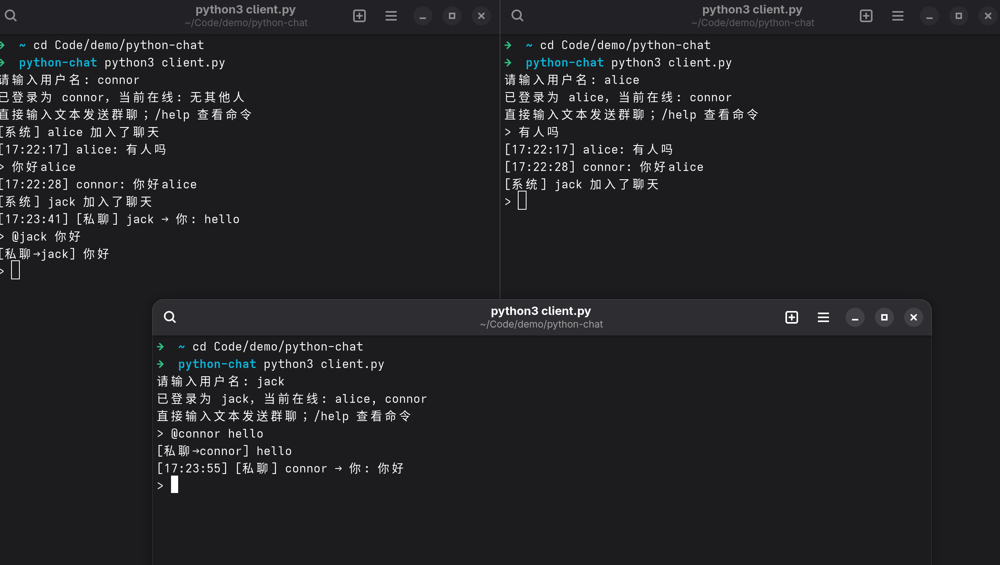
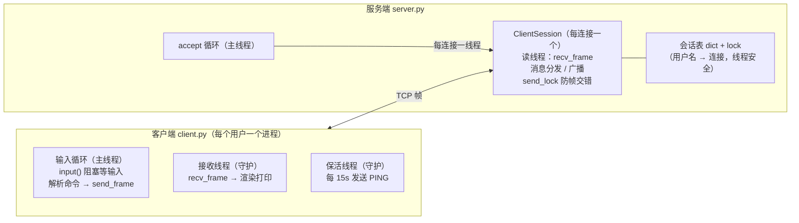

# python-chat — 基于 TCP 自定义协议的多人在线聊天

纯 Python 标准库实现的多用户终端聊天程序：一个服务端 + 多个客户端，
支持多账号登录、群聊广播、点对点私聊、在线用户列表与上线/下线通知。

## 运行截图


## 目录结构

```
├── protocol.py   # 自定义通信协议：帧编解码、消息类型、粘包/半包拆包器
├── server.py     # 服务端：每连接一线程 + 锁保护的会话表
├── client.py     # 客户端：主线程读输入 + 守护线程收消息
└── README.md
```

## 快速开始

```bash
# 终端 1：启动服务器
python3 server.py                 # 默认监听 0.0.0.0:4000

# 终端 2、3、...：各启动一个客户端
python3 client.py                 # 登录时询问用户名
python3 client.py --username alice --host 127.0.0.1 --port 4000
```

## 客户端命令

| 输入 | 作用 |
|---|---|
| 任意文本 | 发送到公共群聊（广播给所有人） |
| `/msg <用户名> <内容>` 或 `@用户名 <内容>` | 私聊（仅对方可见） |
| `/users` | 查看在线用户列表 |
| `/help` | 命令帮助 |
| `/quit` / `/exit` / Ctrl+C / Ctrl+D | 退出 |

## 自定义通信协议

TCP 是无边界的字节流，因此协议用「定长二进制头 + 定长前缀 + JSON 体」
来切分消息边界，帧格式如下：

```
+---------+---------+------+--------------+------------------------+
| MAGIC   | VERSION | TYPE | LENGTH       | PAYLOAD                |
| 2 字节  | 1 字节  | 1 字节 | 4 字节 大端  | LENGTH 字节 UTF-8 JSON |
| b'PC'   | 1       | 枚举 | payload 长度 | 消息内容               |
+---------+---------+------+--------------+------------------------+
```

- TCP粘包/拆包的处理方式：长度前缀 + 累积缓冲，头部写明 body 长度,先读头再按长度读体
- **LENGTH** 前缀声明 payload 字节数，接收端据此切帧，正确处理
  **粘包**（多帧一次到达）与**半包**（一帧分多次到达），见 `protocol.py` 的 `FrameDecoder`。
- **MAGIC** 用于校验帧同步，字节流错乱立即断开；**VERSION** 预留协议升级。
- payload 上限 64KB，超限视为非法帧，服务端直接断开连接。

### 消息类型（protocol.py `MsgType`）

| 方向 | 类型 | Payload 示例 |
|---|---|---|
| C→S | `LOGIN=1` | `{"username": "alice"}` |
| C→S | `CHAT=2` | `{"content": "大家好"}` |
| C→S | `PRIVATE=3` | `{"to": "bob", "content": "悄悄话"}` |
| C→S | `LIST_USERS=4` | `{}` |
| C→S | `PING=5` | `{}`（客户端每 15s 保活） |
| S→C | `PONG=7` | `{}` |
| S→C | `LOGIN_ACK=102` | `{"ok": true, "message": "欢迎 alice", "online": ["bob"]}` |
| S→C | `CHAT_MSG=103` | `{"from": "alice", "content": "大家好", "ts": 1761024000.0}` |
| S→C | `PRIVATE_MSG=104` | `{"from": "alice", "content": "悄悄话", "ts": ...}` |
| S→C | `USER_LIST=105` | `{"users": ["alice", "bob"]}` |
| S→C | `SYSTEM=106` | `{"content": "bob 加入了聊天", "ts": ...}` |
| S→C | `ERROR=107` | `{"code": 4, "message": "用户 bob 不在线"}` |

## 架构



要点：

- **服务端**：每个连接由独立线程服务；会话表（用户名→连接）的读写都在锁内。
  广播时对每个目标连接单独 try/except，单个坏连接不影响其他人；
  每个连接一把发送锁，避免多线程广播时同一 socket 上帧交错。
- **客户端**：登录握手（LOGIN/LOGIN_ACK，重名可在同连接上重试）后进入
  双线程模式；收消息线程打印前先清除当前输入行再重绘提示符，避免交错。
- **断线语义**：TCP 连接断开即下线，服务端统一清理会话并广播 SYSTEM 通知。

## 已知边界

- 仅用户名登录（无密码/持久化），服务端重启后会话清空。
- 服务器停止后，客户端在下一次按键时感知断开并退出。
